# FamilyChat: guide för dig som använder appen

Den här guiden är till dig i familjen som ska använda FamilyChat på din Android-telefon. Du behöver inte kunna något
om datorer. Har du kört fast: fråga den som sköter servern (administratören). Det är aldrig dumt att fråga.

**Kort om vad FamilyChat är:** en privat chatt för familjen. Meddelandena, bilderna och röstmeddelandena är
krypterade på telefonerna och ligger på familjens egen liten dator hemma. Ingen utanför familjen kan läsa dem, inte
ens den som sköter servern.

## Innehåll

1. [Det här behöver du](#1-det-här-behöver-du)
2. [Installera appen](#2-installera-appen)
3. [Tailscale (om ni använder det)](#3-tailscale-om-ni-använder-det)
4. [Skriv in serveradressen](#4-skriv-in-serveradressen)
5. [Skapa ditt konto med inbjudningskoden](#5-skapa-ditt-konto-med-inbjudningskoden)
6. [Aviseringar med ntfy och batterisparläge](#6-aviseringar-med-ntfy-och-batterisparläge)
7. [Skriva, skicka bilder och röstmeddelanden](#7-skriva-skicka-bilder-och-röstmeddelanden)
8. [Grupper](#8-grupper)
9. [Skölden och varningarna](#9-skölden-och-varningarna)
10. [Ny telefon: godkänn den nya telefonen](#10-ny-telefon-godkänn-den-nya-telefonen)
11. [Tappad eller stulen telefon](#11-tappad-eller-stulen-telefon)
12. [Glömt lösenordet](#12-glömt-lösenordet)
13. [Vanliga frågor](#13-vanliga-frågor)

## 1. Det här behöver du

- En Android-telefon.
- Appfilen (`.apk`) från den som sköter servern. Den kommer inte från Play Butik.
- Serveradressen, som ser ut ungefär så här: `https://hemma.example.ts.net`.
- En inbjudningskod från administratören. Den ser ut som `K7M2P-9XQ4W-HT5RB-3NZ8D` och fungerar **en enda gång**.
- Ibland även appen Tailscale (se avsnitt 3). Administratören talar om om du behöver den.

## 2. Installera appen

1. Få appfilen till telefonen. Administratören skickar den på ett sätt hen litar på, till exempel via en kabel eller
   en privat molndisk. Lägg inte appfilen på offentliga ställen.
2. Öppna filen på telefonen (till exempel i appen *Filer* eller i *Hämtade filer*).
3. Android frågar nu om du vill tillåta **installation av okända appar** från just den appen (filhanteraren eller
   webbläsaren du öppnade filen med). Det är normalt för appar som inte kommer från Play Butik. Tryck på
   *Inställningar*, slå på *Tillåt från den här källan* och gå tillbaka.
4. Tryck på *Installera* och sedan *Öppna*.
5. Gå gärna tillbaka till samma inställning och **slå av tillåtelsen igen** när appen är installerad. Då kan inget
   annat installeras av misstag.

Vid en uppdatering installerar du den nya appfilen **över** den gamla. Avinstallera aldrig först: då försvinner dina
nycklar och hela din historik på telefonen, och det går inte att få tillbaka dem.

## 3. Tailscale (om ni använder det)

Många familjer låter servern vara osynlig på internet och använder Tailscale för att komma åt den. Då måste
Tailscale vara på när du chattar.

1. Installera appen **Tailscale** (Play Butik eller F-Droid).
2. Logga in med det konto administratören har bjudit in dig till.
3. Slå på anslutningen. Se till att den står på *Ansluten*. Tailscale kan ställas in att alltid vara på, vilket är
   det smidigaste.

Använder ni i stället en vanlig webbadress (till exempel `https://chat.example.org`) behöver du inte Tailscale.

## 4. Skriv in serveradressen

Första gången du öppnar appen ser du inloggningssidan.

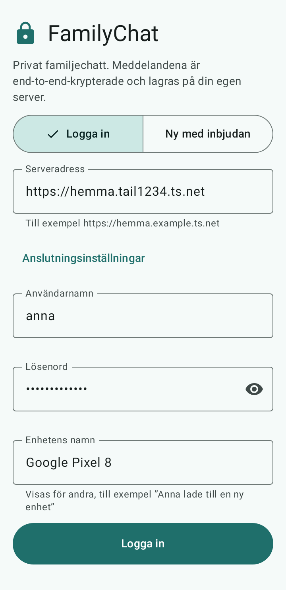

1. Skriv adressen i fältet **Serveradress**. Den ska börja med `https://`.
2. Tryck på **Anslutningsinställningar** och sedan **Testa anslutningen**.

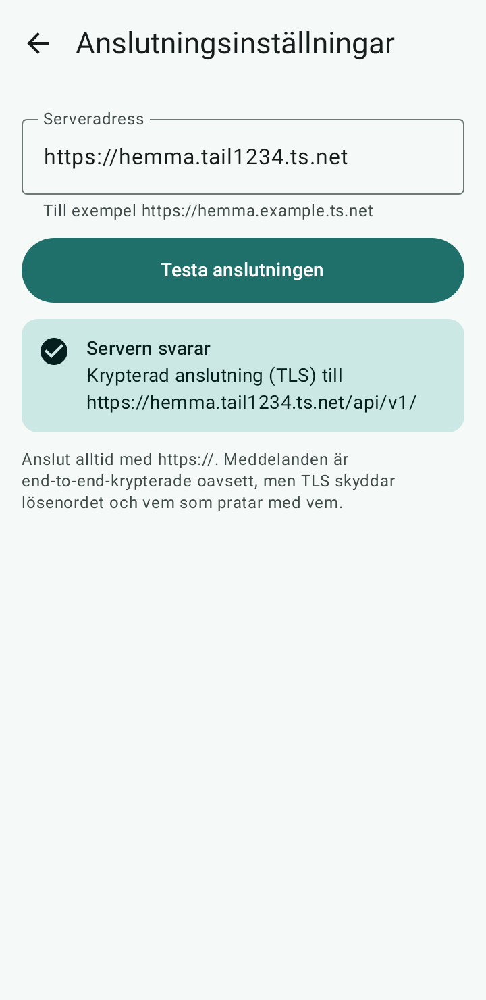

3. Ser du "Servern svarar" och "Krypterad anslutning (TLS)" är allt som det ska.

Står det att servern inte svarar: är Tailscale på? Har telefonen internet? Står det att certifikatet inte är giltigt:
kontrollera att klockan på telefonen går rätt. Hjälper inte det, hör av dig till administratören.

Appen vägrar adresser som börjar med `http://` (utan s). Det är med flit: då skulle ditt lösenord kunna kikas på.

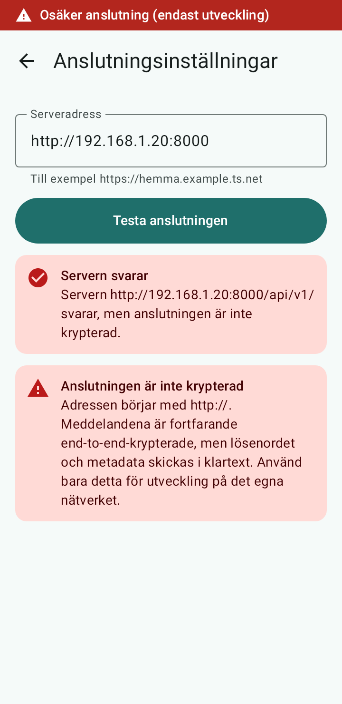

## 5. Skapa ditt konto med inbjudningskoden

1. På inloggningssidan väljer du fliken **Ny med inbjudan**.

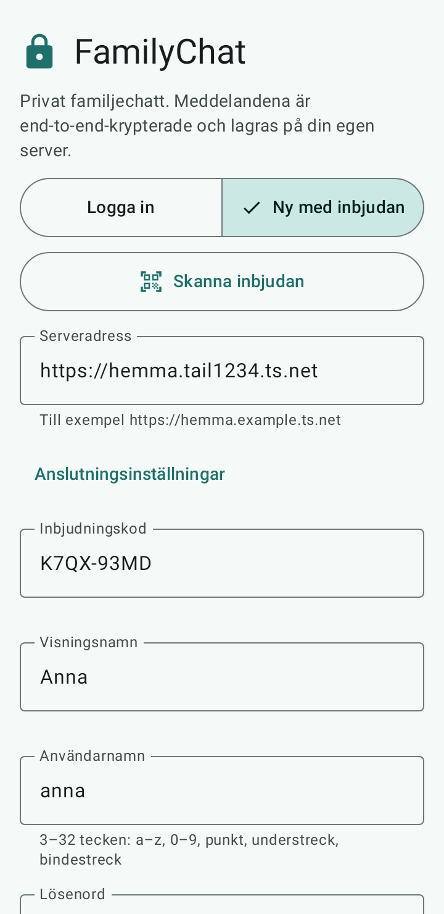

2. Skriv in inbjudningskoden, ett namn som de andra ska se (till exempel "Mormor"), ett användarnamn (små bokstäver
   och siffror, utan mellanslag) och ett lösenord på **minst 10 tecken**. Välj ett lösenord du inte använder någon
   annanstans, och skriv gärna upp det på ett säkert ställe.
3. Under *Enhetens namn* står telefonens modell. Det namnet ser de andra när du lägger till en ny telefon, så det
   får gärna vara något som "Mormors Samsung".
4. Tryck **Skapa konto**.

Koden fungerar bara en gång och går ut efter några dagar. Funkar den inte: be administratören om en ny.
Nästa gång du öppnar appen använder du fliken **Logga in** med användarnamn och lösenord.

## 6. Aviseringar med ntfy och batterisparläge

FamilyChat använder inte Googles tjänster. För att telefonen ska pinga när det kommer ett meddelande använder
familjen appen **ntfy**. Pinget innehåller ingen text, bara "det finns något nytt". Utan ntfy får du meddelanden
först när du öppnar appen, eller med upp till 15 minuters fördröjning.

1. Installera appen **ntfy** (F-Droid eller Play Butik) och öppna den en gång.
2. I ntfy: *Inställningar*, *Standardserver*. Skriv in ntfy-adressen som administratören har gett dig.
3. I FamilyChat: **Inställningar**, **Pushnotiser (UnifiedPush)**, välj **ntfy**. Efter några sekunder står det
   **Aktiv via ntfy**.
4. Svara **Tillåt** om Android frågar om appen får visa aviseringar.

**Batterisparläget är den vanligaste orsaken till att aviseringar uteblir.** Android stänger gärna ner appar som
ligger i bakgrunden. Gör så här för *både* ntfy och FamilyChat:

- Håll fingret på appens ikon, tryck på *Appinfo* (ett i), välj *Batteri* och sedan **Obegränsad** (eller
  "Ingen optimering"). Namnen skiljer lite mellan märken.
- På Samsung, Xiaomi, Huawei och OnePlus finns ofta en extra inställning som heter något i stil med *Vilande appar*,
  *Autostart* eller *Skyddade appar*. Lägg in båda apparna som undantag.
- Guide för just din telefon: https://dontkillmyapp.com

Kommer aviseringarna ändå inte? Då kommer meddelandena ändå fram, bara senare. Berätta för administratören.

## 7. Skriva, skicka bilder och röstmeddelanden

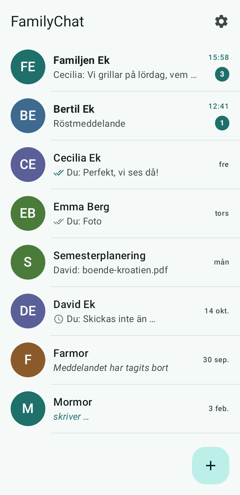

- **Nytt samtal:** tryck på plusknappen (+) nere till höger. Välj en person (du kan söka på namn) för ett samtal mellan två, eller
  *Ny grupp*.
- **Skriva:** skriv i fältet längst ned och tryck på pilen (*Skicka*).
- **Svara på ett visst meddelande:** håll fingret på meddelandet och välj *Svara*. Där finns också *Redigera*
  (för dina egna meddelanden), *Kopiera* och *Ta bort*. Att ta bort ett meddelande tar bort det för alla i samtalet.
- **Skicka bild eller film:** tryck på gemet (*Bifoga*) och välj *Foto eller video*. Där finns även *Dokument*.

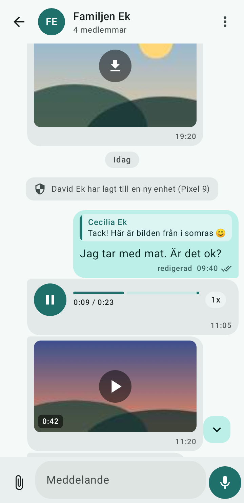

- **Röstmeddelande:** håll in mikrofonknappen medan du pratar och släpp för att skicka. Du kan också trycka en gång
  för att börja spela in, och sedan *Skicka inspelningen* eller *Släng inspelningen*. Första gången frågar
  Android om appen får använda mikrofonen: svara ja.

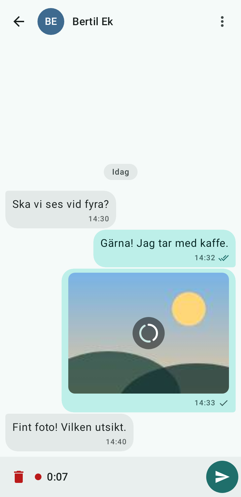

- **Lyssna:** tryck på play. Med knappen för hastighet kan du lyssna snabbare eller långsammare.
- **Utan internet:** meddelandet ligger kvar med texten "Skickades inte. Tryck för att försöka igen." Tryck på det
  när du har uppkoppling igen.

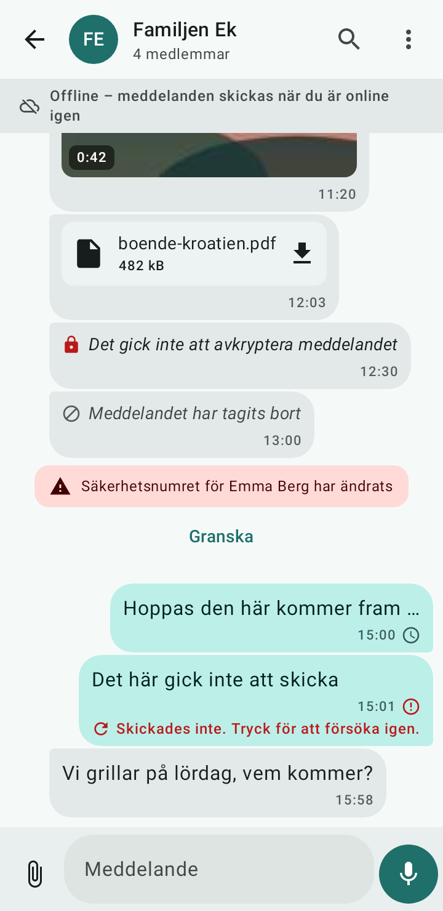

## 8. Grupper

1. Tryck på plusknappen och välj **Ny grupp**.
2. Ge gruppen ett namn, välj vilka som ska vara med och tryck **Skapa grupp**.

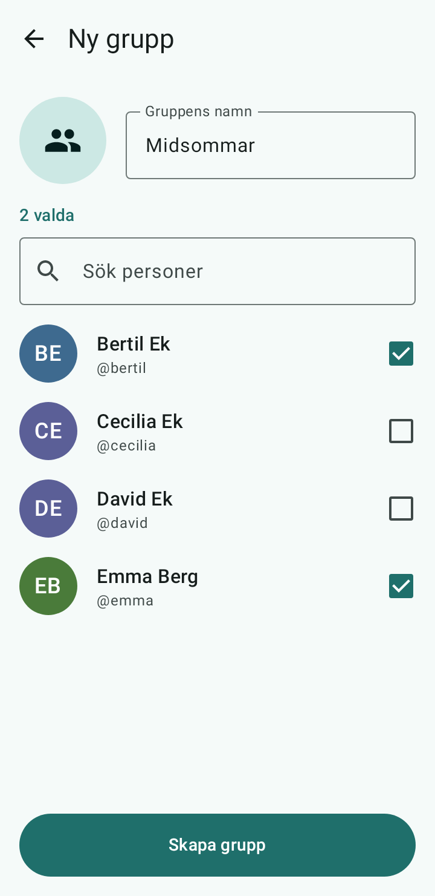

3. Tryck på gruppens namn högst upp för **Gruppinformation**: byt namn, byt bild, lägg till eller ta bort
   personer. Det är den som skapade gruppen (och andra administratörer i gruppen) som kan ändra den.

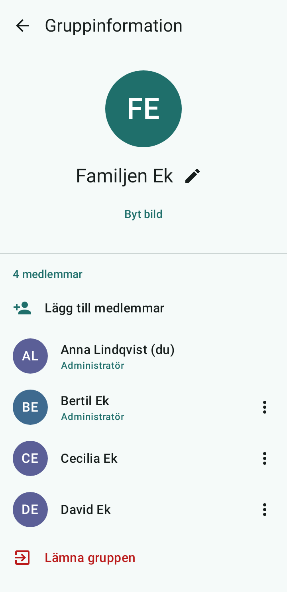

4. Vill du själv gå ur gruppen väljer du **Lämna gruppen**. Då får du inga fler meddelanden därifrån och de gamla
   försvinner från din telefon.

När någon läggs till eller lämnar gruppen skriver appen det i samtalet, så ingen kan försvinna eller dyka upp
obemärkt.

## 9. Skölden och varningarna

Högst upp i varje samtal, bredvid namnet, finns en symbol. Den berättar om du kan vara säker på att du pratar med
rätt person.

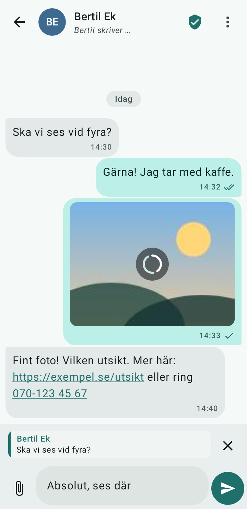

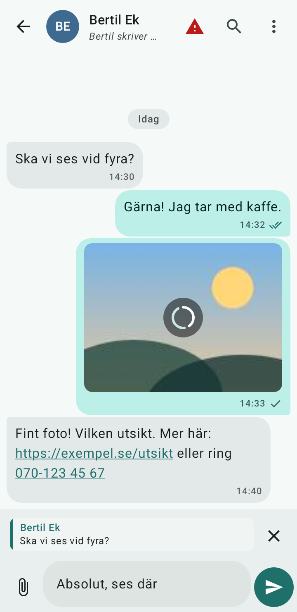

| Du ser | Det betyder | Gör så här |
|---|---|---|
| Grön sköld med bock, "Verifierad" | Du har jämfört säkerhetsnumret med personen. Allt är som det ska. | Inget. |
| Ingen grön sköld | Du har inte jämfört numret med personen än. Chatten är ändå krypterad. | Gå gärna igenom *Säkerhetsnummer* med personen nästa gång ni ses (se nedan). |
| Röd varningstriangel, "Granska" | Något har ändrats och väntar på att du ska titta på det. | Läs varningen, se nedan. |
| **"Anna har lagt till en ny enhet"** | Anna har loggat in på en ny telefon eller installerat om appen. | Oftast helt ofarligt. Har hon skaffat ny telefon? Fråga henne. Inget skickas till den nya enheten förrän du godkänt den. |
| **"Säkerhetsnumret har ändrats"** | Annas nyckel är en annan än förut. Det kan bero på ny telefon eller ominstallation, men i sällsynta fall på att någon försöker låtsas vara henne. | **Ring henne** och fråga. Godkänn inte innan du fått ett ja. |

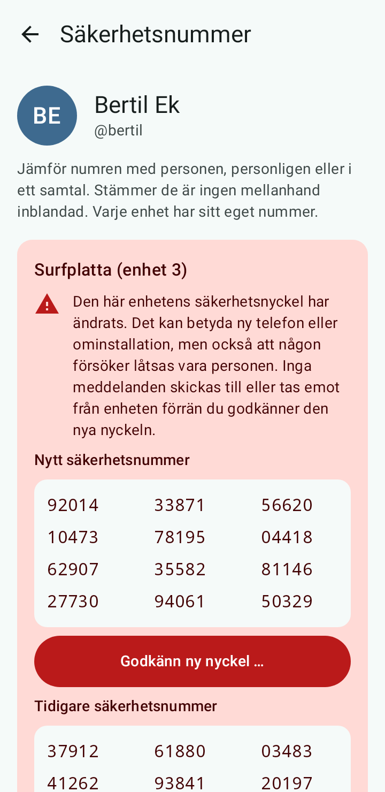

**Så gör du när du får en varning:**

1. Tryck på **Granska**.
2. **Ring personen** (ett vanligt telefonsamtal, inte ett meddelande i FamilyChat) och fråga: "Har du bytt telefon
   eller installerat om appen?"
3. Svarar hon ja: läs upp varandras *Säkerhetsnummer* (60 siffror) för varandra. Stämmer de, tryck **Godkänn ny
   nyckel** och bekräfta. Tryck gärna också *Markera som verifierad*.
4. Svarar hon nej, eller du inte når henne: **godkänn inte.** Hör av dig till administratören.

Medan en varning väntar skickas inget till den enheten och inget tas emot därifrån. Det är en säkerhetsfunktion, inte
ett fel.

**Jämföra säkerhetsnummer (rekommenderas):** öppna samtalet, tryck på personens namn eller menyn, välj
**Säkerhetsnummer**. Läs upp numret för varandra, ses ni eller ringer ni. Stämmer det: **Markera som verifierad**.

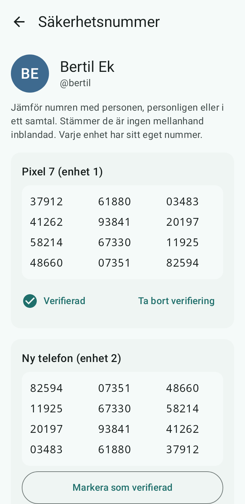

## 10. Ny telefon: godkänn den nya telefonen

När du skaffar en ny telefon loggar du in med ditt användarnamn och lösenord. Den nya telefonen blir då en egen
*enhet* med nya nycklar. De andra i familjen ser "Anna har lagt till en ny enhet".

**Gamla meddelanden följer inte med.** De är krypterade för den gamla telefonen och kan inte läsas på den nya. Behåll
den gamla telefonen så länge du vill kunna läsa historiken där.

**Viktigt: du måste godkänna din nya telefon på den gamla.** Det här är en medveten säkerhetsspärr: ett konto som
någon lagt till en okänd telefon på ska inte kunna skicka något förrän du själv sagt ja. Så här gör du:

1. Logga in på den nya telefonen (avsnitt 5, fliken *Logga in*).
2. Ta fram den **gamla** telefonen (den som fortfarande är inloggad).
3. Tryck på kugghjulet uppe till höger (**Inställningar**) och sedan **Säkerhetsnummer för mina enheter**.
4. Där syns den nya enheten. Jämför numret på båda telefonerna, tryck **Godkänn ny nyckel** och bekräfta.

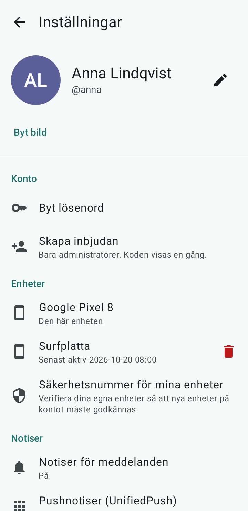

**Tills du har gjort det kan den gamla telefonen inte skicka meddelanden**, och de nya meddelandena kommer inte fram
till den nya heller. Det är med flit. Har du redan lämnat bort eller förlorat den gamla telefonen går det inte att
godkänna därifrån. Då gäller avsnitt 11: be administratören om hjälp.

När allt fungerar kan du logga ut på den gamla telefonen (*Logga ut* i inställningarna). Observera att utloggning
raderar meddelanden och nycklar från den telefonen.

## 11. Tappad eller stulen telefon

1. **Ta det lugnt.** Meddelandena på telefonen skyddas av skärmlåset och av kryptering. Har telefonen en PIN-kod
   eller ett mönster är risken liten.
2. Har du en annan telefon eller surfplatta med FamilyChat: öppna **Inställningar**, **Enheter**, tryck på papperskorgen
   vid den borttappade telefonen (*Återkalla*). Den loggas ut direkt och får inga fler meddelanden.
3. Byt sedan lösenordet: **Inställningar**, **Byt lösenord**. Alla andra enheter loggas ut.
4. Har du ingen annan enhet: **kontakta administratören** så snart du kan. Hen kan stänga av telefonen från servern.
5. Logga in på din nya telefon (avsnitt 5) och berätta för familjen att du har ny telefon. Kontakterna ser att en ny
   enhet har lagts till. Det är rätt, och nu vet de varför.

Äldre meddelanden går inte att läsa på den nya telefonen (se avsnitt 10).

## 12. Glömt lösenordet

Det går att få ett nytt. Be administratören om en **engångskod** för återställning av lösenord. Den gäller i ett dygn.
Du anger koden och väljer ett nytt lösenord. Administratören ska ge dig koden på ett säkert sätt, helst muntligt
eller i ett privat samtal.

Efter en återställning loggas du ut överallt. Telefonen du återställer på blir en ny enhet, och äldre meddelanden går
inte att läsa. Det är precis som vid en ny telefon (avsnitt 10), och dina kontakter får meddelandet "ny enhet".

## 13. Vanliga frågor

**Kan administratören läsa mina meddelanden?**
Nej. Meddelandena krypteras på din telefon och kan bara läsas på mottagarens telefon. Administratören ser att
man har konton, och vem som skrev till vem och när, men aldrig vad som stod.

**Varför kommer inga aviseringar?**
Nästan alltid batterisparläget. Gå igenom avsnitt 6 för både ntfy och FamilyChat. Kontrollera också att
*Inställningar → Pushnotiser* visar "Aktiv via ntfy", och att Tailscale är på om ni använder det.

**Appen säger "Servern svarar inte".**
Är Tailscale på? Har du internet? Prova att öppna serveradressen följt av `/healthz` i telefonens webbläsare. Står det
`ok` är servern uppe. Annars: hör av dig till administratören, servern kan behöva startas om.

**Det står "Det gick inte att avkryptera meddelandet".**
Meddelandet skickades till en enhet som inte fanns än, eller så har en nyckel ändrats. Tryck på **Granska** om den
syns. Annars: be avsändaren skicka det igen.

**Jag fick ett meddelande om att jag blivit utloggad.**
Det händer när lösenordet byts, eller när administratören eller du själv tagit bort enheten. Logga in igen. Hände
det utan att du gjort något: ring administratören.

**Måste jag jämföra säkerhetsnummer?**
Nej, men det är det som gör chatten riktigt säker. Det räcker att göra det en gång per person, när ni ses.

**Kan jag ha appen på flera enheter, till exempel telefon och surfplatta?**
Ja, upp till ett antal enheter. Varje ny enhet måste godkännas som i avsnitt 10.

**Vad händer om jag avinstallerar appen?**
Nycklarna och alla meddelanden på telefonen raderas och kan inte återskapas. Avinstallera aldrig för att "rensa".
Uppdatera genom att installera den nya appfilen över den gamla.

**Meddelanden försvinner efter en tid?**
Servern sparar inga meddelanden för alltid: den raderar dem en tid efter att de levererats. De som är hos dig på
telefonen ligger kvar tills du själv tar bort dem eller loggar ut.

**Kan jag låsa appen?**
Ja: *Inställningar → Applås* låser upp med fingeravtryck, ansikte eller skärmlås. Där kan du också stänga av
skärmdumpar och välja vad aviseringarna visar.

**Något annat?** Fråga administratören. Skriv gärna ner vad som stod på skärmen, och om det finns ett
*felnummer* (request-ID) i felmeddelandet, skicka med det.
