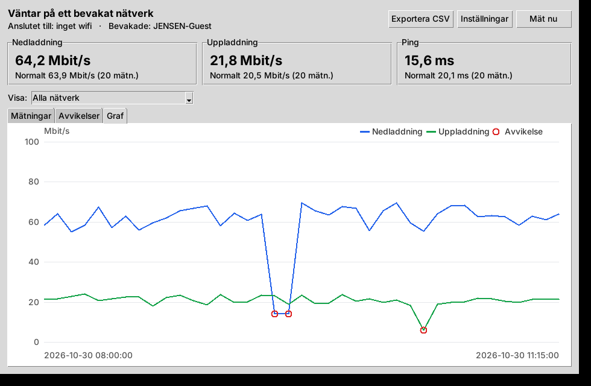

# Fartvakt

En Linux-app som automatiskt och kontinuerligt mäter internethastigheten när datorn är ansluten
till ett visst wifi-nätverk (som standard **JENSEN-Guest**). Varje mätning sparas i appen. När en
mätning avviker tydligt från vad som är normalt på nätverket noteras avvikelsen tillsammans med
den uppmätta hastigheten, och en notis visas.


## Installera

Ladda ner [`dist/fartvakt_1.0.0_all.deb`](dist/fartvakt_1.0.0_all.deb) och installera den (Ubuntu,
Debian, Linux Mint, Pop!_OS m.fl.):

```bash
sudo apt install ./fartvakt_1.0.0_all.deb
```

Öppna sedan **Fartvakt** från appmenyn. Bevakningen körs som en bakgrundstjänst
(`systemctl --user status fartvakt`) som startar vid inloggning – appen behöver alltså inte vara
öppen för att mätningarna ska göras.

Avinstallera med `sudo apt remove fartvakt`. Mätningarna ligger kvar i
`~/.local/share/fartvakt/` tills du tar bort mappen.

## Så fungerar det

- Var 30:e sekund tittar tjänsten på vilket wifi-nätverk datorn sitter på (via NetworkManager,
  annars `iwgetid`).
- När du kommer in på ett bevakat nätverk mäts hastigheten direkt och sedan var 5:e minut så länge
  du är kvar. Lämnar du nätverket pausas mätningarna.
- En mätning består av ping (median av 6 förfrågningar), nedladdning och uppladdning med 4
  parallella anslutningar mot Cloudflares hastighetsserver (speed.cloudflare.com). Varje del tar
  högst 10 sekunder och använder som mest 20 MB ned och 5 MB upp.
- **Avvikelser:** varje mätning jämförs med medianen av de 20 senaste lyckade mätningarna på
  samma nätverk. Skiljer sig ned, upp eller ping mer än 30 % (och minst 1 Mbit/s respektive
  10 ms) sparas en avvikelse med uppmätt värde, normalvärde och förändring i procent – både
  när det blir sämre och när det blir bättre. Avvikelser börjar noteras efter 5 mätningar.
- En misslyckad mätning (ingen anslutning, eller nätverket kräver inloggning i webbläsaren)
  sparas också som en avvikelse, *avbrott*. Notis visas bara för det första avbrottet i rad.

Allt går att ändra under **Inställningar** i appen: vilka nätverk som bevakas (knappen *Lägg till
nuvarande nätverk* lägger till det du sitter på), intervall, gräns för avvikelse, datamängd och
notiser. Inställningarna sparas i `~/.config/fartvakt/config.json`.

## Appen

| Mätningar | Graf |
|---|---|
|  |  |

- **Mät nu** gör en mätning direkt, oavsett nätverk.
- **Mätningar** listar alla mätningar; avvikande är röda (sämre) eller orange (bättre).
- **Avvikelser** listar varje avvikelse med uppmätt värde, normalvärde och förändring.
- **Graf** visar ned- och uppladdning över tid med avvikelserna inringade.
- **Exportera CSV** sparar alla mätningar till en fil som går att öppna i t.ex. LibreOffice Calc.

## Kommandoraden

```text
fartvakt                 öppna appen
fartvakt mat             mät nu
fartvakt status          anslutet nätverk, bevakning och normalvärden
fartvakt historik -n 50  de senaste mätningarna
fartvakt avvikelser      de senaste avvikelserna
fartvakt export fil.csv  alla mätningar som CSV
```

Tjänstens logg: `journalctl --user -u fartvakt -f`.

## Utveckla

Python 3 utan externa beroenden (GUI:t använder Tk, `python3-tk`).

```bash
python3 -m unittest discover -s tests
```

```bash
./build-deb.sh
```

`build-deb.sh` behöver bara `dpkg-deb` och skriver paketet till `dist/`. Versionen läses från
`src/fartvakt/__init__.py`.

| Fil | Innehåll |
|---|---|
| `src/fartvakt/daemon.py` | bakgrundstjänsten: följer nätverket och mäter enligt intervallet |
| `src/fartvakt/speedtest.py` | själva mätningen (ping, ned, upp) |
| `src/fartvakt/analysis.py` | avgör vad som är en avvikelse |
| `src/fartvakt/monitor.py` | mät → spara → leta avvikelser → notis |
| `src/fartvakt/storage.py` | SQLite-databasen i `~/.local/share/fartvakt/` |
| `src/fartvakt/gui.py` | appens fönster |
| `packaging/` | systemd-tjänst, .desktop-fil, ikon och Debian-skript |
