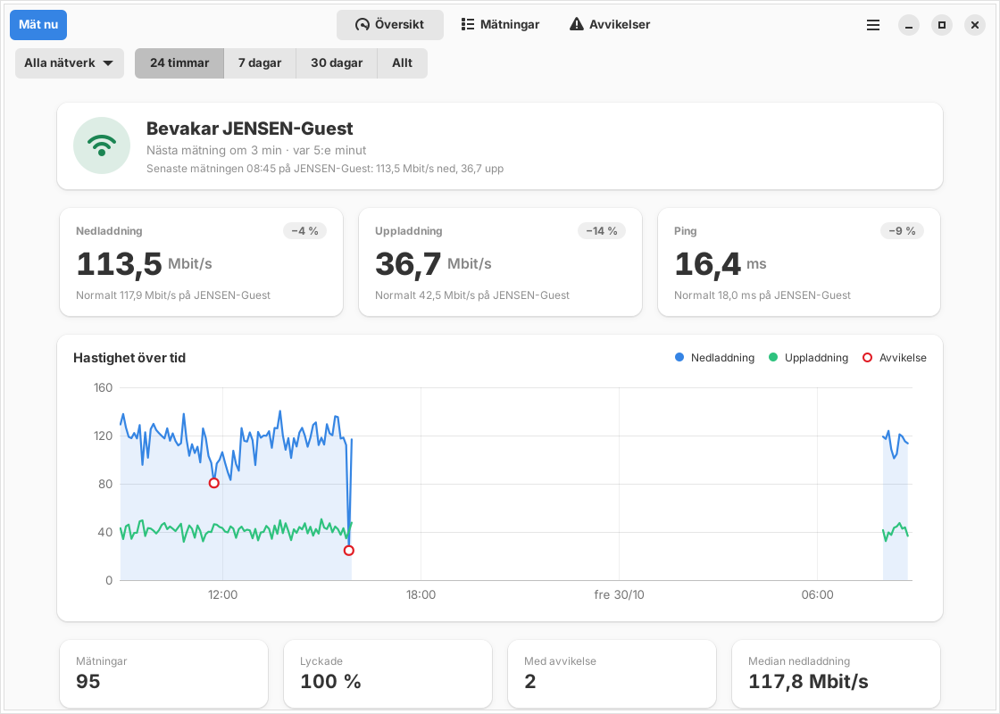
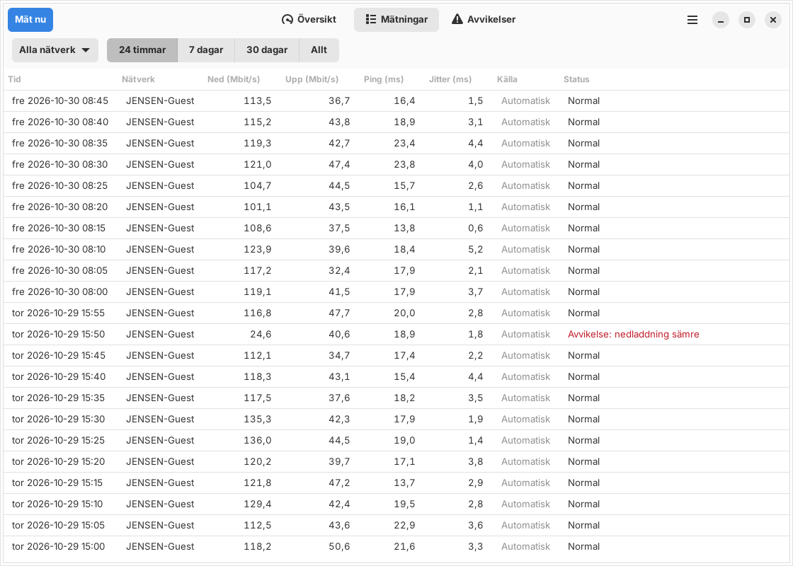
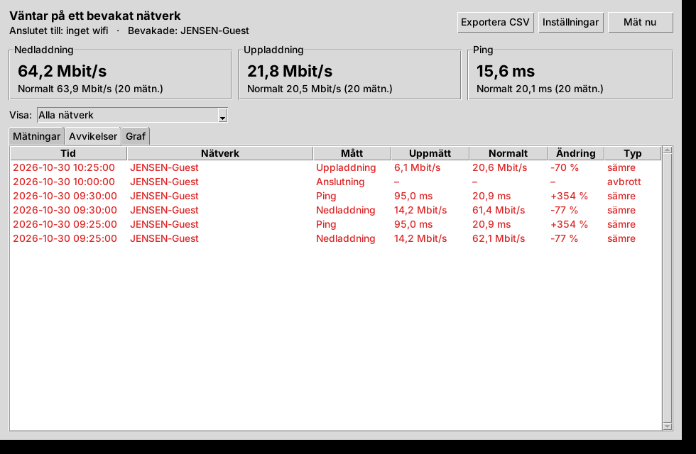
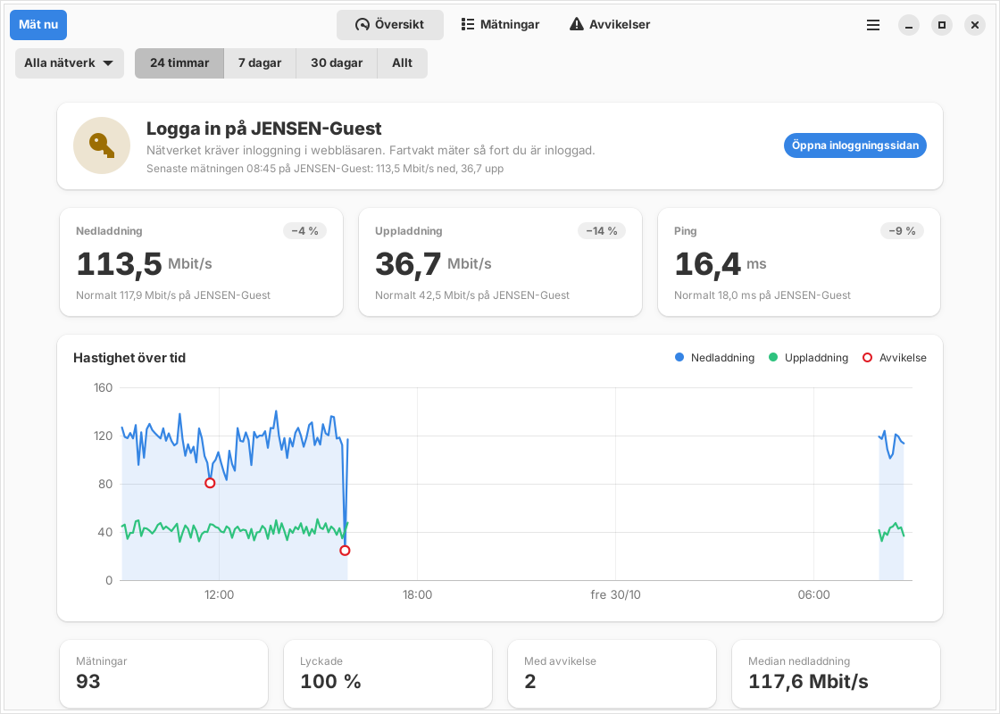
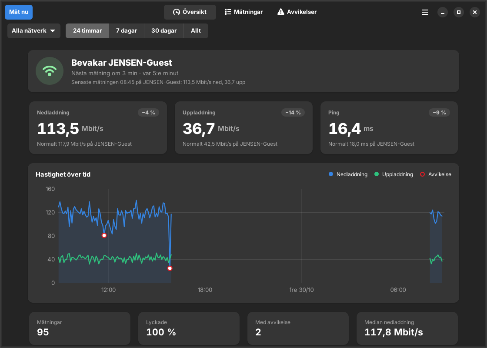
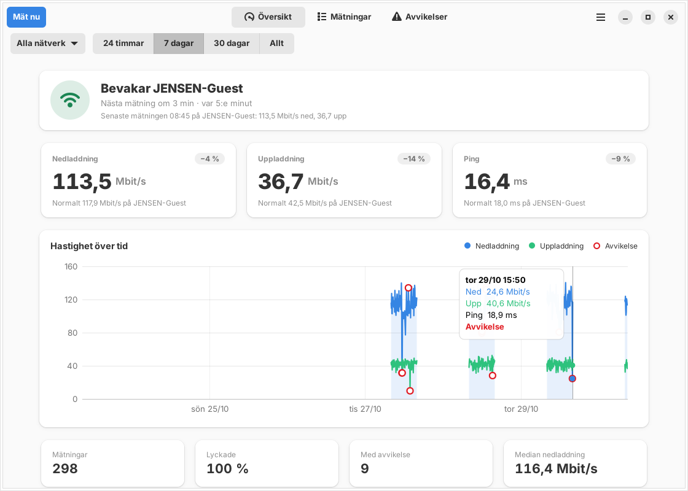
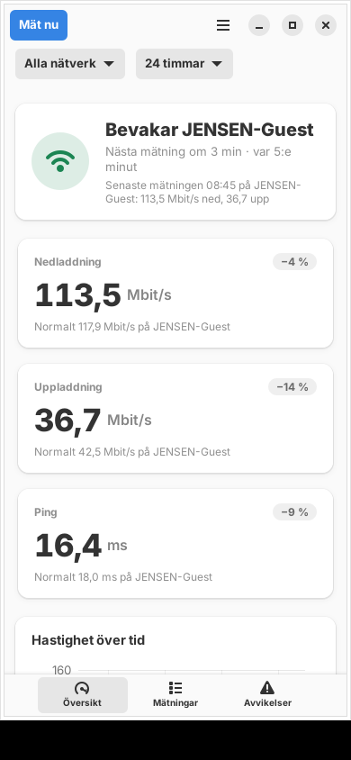
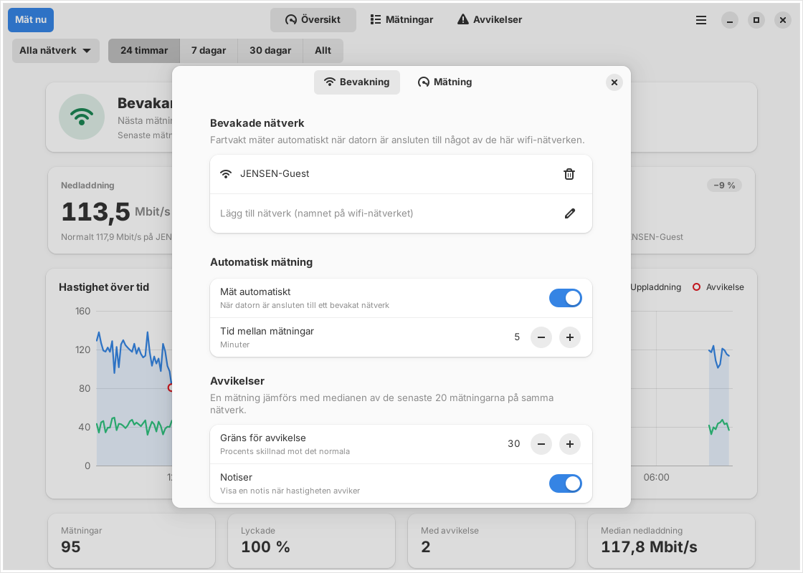

# Fartvakt

Fartvakt mäter internethastigheten automatiskt och kontinuerligt när datorn är ansluten till
ett visst wifi-nätverk (som standard **JENSEN-Guest**). Varje mätning sparas i appen. När en
mätning avviker tydligt från vad som är normalt på nätverket noteras avvikelsen tillsammans med
den uppmätta hastigheten, och en notis visas.



## Installera

Kräver Ubuntu 24.04 eller nyare, Debian 13 eller en annan distribution med GTK 4.12 och
libadwaita 1.5 (till exempel Linux Mint 22 och Pop!_OS 24.04).

Ladda ner [`dist/fartvakt_1.2.3_all.deb`](dist/fartvakt_1.2.3_all.deb) och installera den:

```bash
sudo apt install ./fartvakt_1.2.3_all.deb
```

Öppna sedan **Fartvakt** från appmenyn. Bevakningen sköts av en bakgrundstjänst som startar
direkt vid installationen och sedan vid varje inloggning. Appen behöver alltså inte vara öppen
för att mätningarna ska göras. En uppgradering från 1.0 behåller alla mätningar.

Avinstallera med `sudo apt remove fartvakt`. Mätningarna ligger kvar i
`~/.local/share/fartvakt/` tills du tar bort mappen.

## Så fungerar det

- Tjänsten tittar var 30:e sekund efter vilket wifi-nätverk datorn sitter på (via
  NetworkManager, annars `iwgetid`).
- När du kommer in på ett bevakat nätverk väntar den 15 sekunder, så att anslutningen hinner
  bli klar, och mäter sedan direkt. Därefter mäter den var 5:e minut så länge du är kvar.
  Lämnar du nätverket pausas mätningarna. Tiden räknas rätt även om datorn har legat i viloläge,
  och efter viloläget väntar Fartvakt in nätverket innan den mäter igen.
- Byter datorn nätverk mitt i en mätning sparas inte resultatet, så att det inte hamnar på fel
  nätverk. Går internettrafiken via kabel eller VPN, fast datorn är ansluten till det bevakade
  wifi-nätverket, mäter Fartvakt inte alls, eftersom resultatet då inte skulle visa
  wifi-nätverkets hastighet.
- En mätning består av ping (median av 8 förfrågningar, med serverns egen handläggningstid
  borträknad), nedladdning och uppladdning. Upp- och nedladdning görs med 4 parallella
  anslutningar mot Cloudflares hastighetsserver (speed.cloudflare.com). Varje del tar högst
  10 sekunder. Den första fjärdedelen av tiden räknas inte med, så att TCP:s långsamma uppstart
  inte drar ner resultatet, och uppladdad data räknas först när servern har tagit emot den.
- **Avvikelser:** varje mätning jämförs med medianen av de 20 senaste lyckade mätningarna på
  samma nätverk. Skiljer sig ned, upp eller ping mer än 30 % (och minst 1 Mbit/s respektive
  10 ms) sparas en avvikelse med uppmätt värde, normalvärde och förändring i procent, både när
  det blir sämre och när det blir bättre. Avvikelser börjar noteras efter 5 mätningar.
- En misslyckad mätning sparas också som en avvikelse, *avbrott*, med orsaken. En notis visas
  bara för det första avbrottet i en följd av avbrott.
- **Gästnätverk med inloggningssida:** om NetworkManager ser att nätverket kräver inloggning i
  webbläsaren väntar Fartvakt i stället för att fylla historiken med misslyckade mätningar. Du
  får en notis, och översikten får en knapp som öppnar inloggningssidan. Fartvakt kontrollerar
  var 30:e sekund om du har loggat in och mäter direkt när du har gjort det.

## Appen

| Mätningar | Avvikelser |
|---|---|
|  |  |

- **Översikt** visar bevakningens läge och när nästa mätning görs. Där finns också den
  senaste mätningen jämförd med det normala, en graf och statistik för vald period.
- I **grafen** syns ned- och uppladdning över tid. Avvikelserna är inringade, och om du för
  muspekaren över grafen visas värdena för varje mätning. Tider då datorn inte var på nätverket
  lämnas tomma.
- **Mätningar** och **Avvikelser** är tabeller som går att sortera på varje kolumn.
- Välj nätverk och period (24 timmar, 7 dagar, 30 dagar eller allt) i raden under rubriken.
- **Mät nu** (Ctrl+M) gör en mätning direkt, oavsett nätverk. Förloppet syns i appen.
- **Exportera som CSV** (Ctrl+E) sparar alla mätningar i en fil som öppnas direkt i svenska
  Excel och LibreOffice Calc (semikolon och decimalkomma).
- **Inställningar** (Ctrl+,) styr vilka nätverk som bevakas, intervallet, gränsen för
  avvikelse, notiserna och datamängden. Där syns också hur mycket data mätningarna använder.
  Ändringar gäller direkt, även för bakgrundstjänsten. Inställningarna sparas i
  `~/.config/fartvakt/config.json`.

Appen följer systemets ljusa eller mörka tema och fungerar även i smala fönster.



| Mörkt tema | Graf | Smalt fönster |
|---|---|---|
|  |  |  |



## Kommandoraden

```text
fartvakt                 öppna appen
fartvakt mat             mät nu
fartvakt status          anslutet nätverk, bevakningens läge och normalvärden
fartvakt historik -n 50  de senaste mätningarna
fartvakt avvikelser      de senaste avvikelserna
fartvakt export fil.csv  alla mätningar som CSV
```

Se också `man fartvakt`. Tjänstens logg visas med `journalctl --user -u fartvakt -f`.

## Utveckla

Fartvakt är skriven i Python 3 och har inga beroenden utanför Debian/Ubuntu. Gränssnittet
använder GTK 4 och libadwaita via PyGObject.

```bash
sudo apt install python3-gi python3-gi-cairo gir1.2-gtk-4.0 gir1.2-adw-1
```

Starta appen från källkoden:

```bash
PYTHONPATH=src python3 -m fartvakt
```

Kör alla tester. Finns ingen skärm körs GUI-testerna i Xvfb (`sudo apt install xvfb`):

```bash
./run-tests.sh
```

Bygg paketet med:

```bash
./build-deb.sh
```

`build-deb.sh` behöver bara `dpkg-deb` och `gzip` och skriver paketet till `dist/`. Versionen
läses från `src/fartvakt/__init__.py`. Paketet ger inga anmärkningar från
`lintian --pedantic`.

| Fil | Innehåll |
|---|---|
| `src/fartvakt/daemon.py` | bakgrundstjänsten: följer nätverket och mäter enligt intervallet |
| `src/fartvakt/speedtest.py` | själva mätningen (ping, ned, upp) |
| `src/fartvakt/analysis.py` | avgör vad som är en avvikelse |
| `src/fartvakt/monitor.py` | mät, spara, leta avvikelser och visa notis |
| `src/fartvakt/storage.py` | SQLite-databasen i `~/.local/share/fartvakt/` |
| `src/fartvakt/status.py` | tjänstens läge, som appen läser |
| `src/fartvakt/gui.py`, `preferences.py`, `chart.py` | appens fönster, inställningar och graf |
| `src/fartvakt/formatting.py`, `plotting.py` | texter och grafens axlar (testbara utan GTK) |
| `packaging/` | systemd-tjänst, .desktop-fil, AppStream, ikoner, man-sida och Debian-skript |

## Licens

MIT, se [LICENSE](LICENSE).
