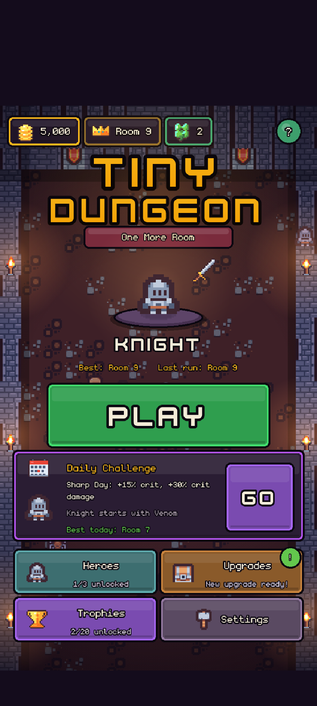
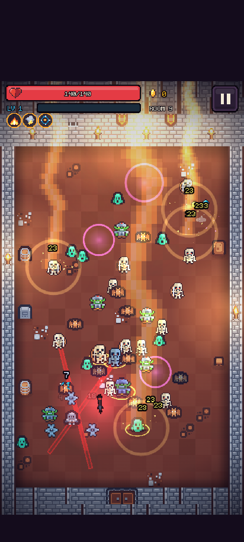
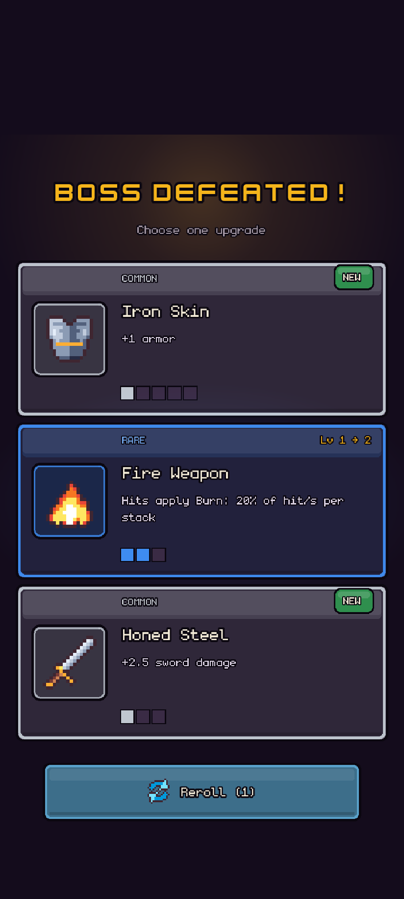
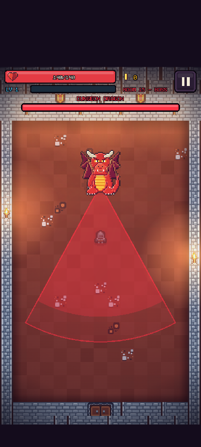
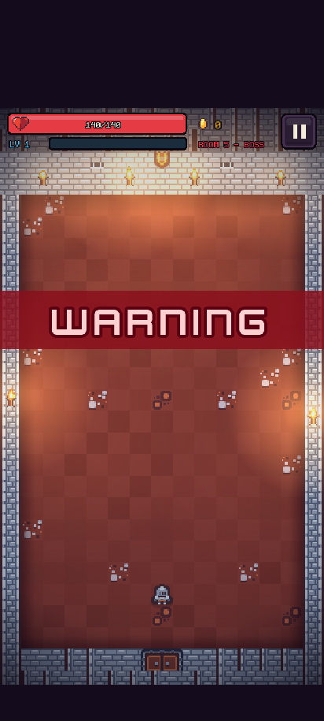
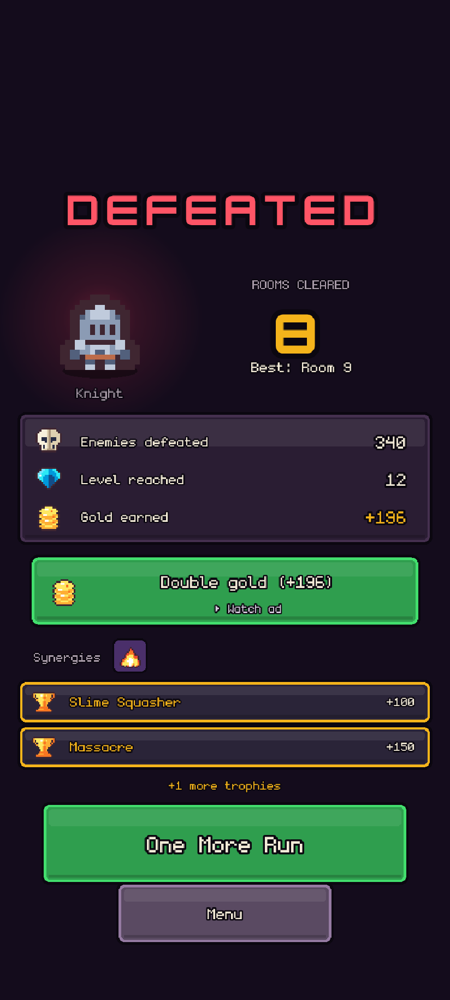
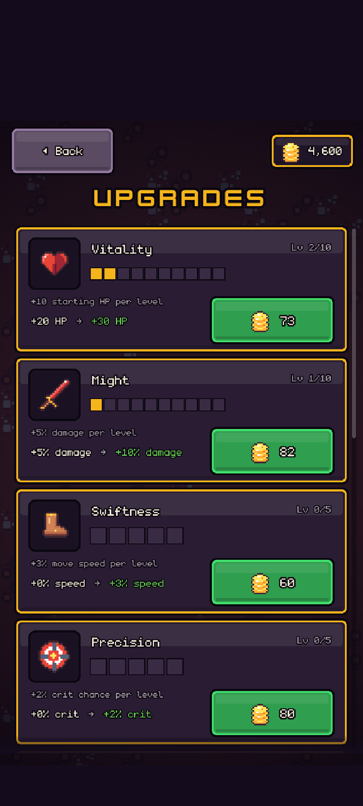
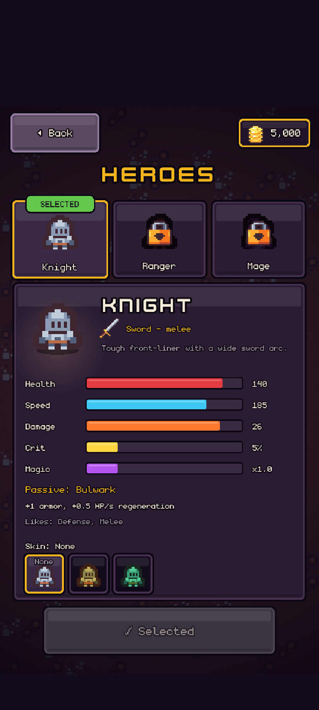
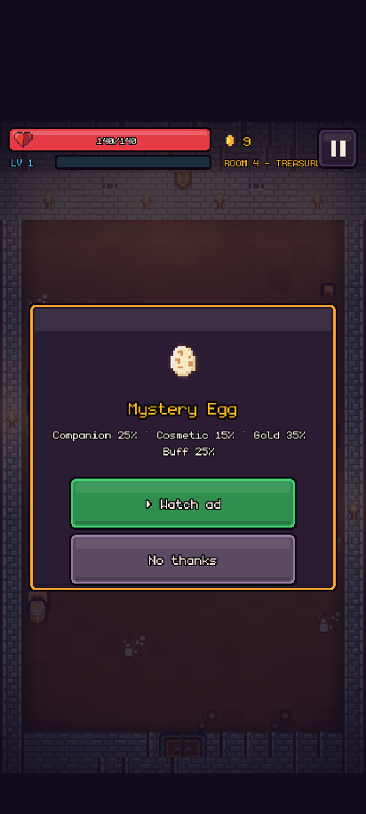

# Tiny Dungeon – One More Room

A portrait (9:16) pixel-art roguelite auto-battler for YouTube Playables. It also runs in any browser.

Built with Phaser 3.90, TypeScript and Vite.

## Screenshots

<table>
  <tr>
    <td></td>
    <td></td>
    <td></td>
  </tr>
  <tr>
    <td></td>
    <td></td>
    <td></td>
  </tr>
  <tr>
    <td></td>
    <td></td>
    <td></td>
  </tr>
</table>

## How it plays

The hero attacks automatically. You only move: drag anywhere, or use WASD / arrow keys.

- A room lasts about 15–25 seconds.
- Clear a room, pick 1 of 3 upgrades, then choose the next door.
- Every 5th room is a boss: Giant Slime, Skeleton King, Dungeon Dragon, Spider Queen, the Lich and the Mimic King (rooms 5 to 30). They return every 30 rooms, scaled, so the run is endless.
- Death banks your gold for permanent upgrades.

## Content

| Type | Count | Notes |
|---|---|---|
| Heroes | 3 | Knight (sword), Ranger (bow), Mage (staff) |
| Weapons | 3 | |
| Upgrades | 43 | 4 rarities |
| Synergies | 15 | 3 of them evolutions |
| Enemy types | 10 | Includes unlockable variants |
| Bosses | 6 | Telegraphed multi-phase attacks |
| Room types | – | Elite, treasure, shrine, boss |
| Permanent shop | 10 upgrades | |
| Achievements | 24 | |

Also included: Mystery Egg, a deterministic daily challenge, and cosmetic skins.
## Commands

Run these in `tiny-dungeon/`.

| Command | Does |
|---|---|
| `npm install` | Installs dependencies |
| `npm run dev` | Starts the dev server |
| `npm test` | Runs the unit tests (vitest) |
| `npm run typecheck` | Type-checks the project |
| `npm run build` | Production build |
| `npm run package` | Builds, validates against the Playables bundle rules, and zips to `release/tiny-dungeon-playables.zip` |
| `npm run sim -- --runs 2000 --skill average --meta none` | Headless balance simulation, see [docs/BALANCE.md](docs/BALANCE.md) |
| `node tools/smoke.mjs` | Headless Playwright play-through of gameplay |
| `node tools/ui-smoke.mjs` | Headless Playwright play-through of the UI |
| `python3 tools/build_assets.py` | Rebuilds sprite atlases and mp3s from the CC0 packs in `../assets` |

The smoke scripts write screenshots to `docs/screens/` (gitignored).

## URL parameters

| Parameter | Effect |
|---|---|
| `?mockads=1` | Enables the mock rewarded-ad provider in a production build. `?mockads=fail` and `?mockads=cancel` force the outcome. Dev builds always use the mock. |
| `?debug=1` | Enables debug hooks (`window.__td`, `window.__game`) and the test parameters below |
| `?room=N` | Test parameter: room number |
| `?type=elite\|treasure\|shrine` | Test parameter: room type |
| `?up=upgrade_id,upgrade_id` | Test parameter: upgrades |
| `?god=1` | Test parameter: god mode |

## Structure

| Path | Contents |
|---|---|
| `src/core` | Pure rules, no Phaser |
| `src/data` | Content definitions |
| `src/config/balance.ts` | All tunable numbers |
| `src/platform` | Browser and YouTube Playables adapters |
| `src/save` | Versioned save, via the platform |
| `src/rewards` | Reward service, mock / YouTube / null ad providers, Mystery Egg |
| `src/audio` | Audio |
| `src/game` | Phaser scenes, entities, systems, UI |

See [docs/ARCHITECTURE.md](docs/ARCHITECTURE.md) for more.

## YouTube Playables

- The SDK script loads first in `index.html`.
- Inside Playables the game uses `ytgame.game.loadData` / `saveData` for saves, `ytgame.system.onPause` / `onResume` and the audio mute events, and sends the rooms cleared as the score.
- Third-party ad SDKs are not allowed.
- The YouTube rewarded-ad API (`ytgame.ads.requestRewardedAd`) is wrapped but switched off with `REWARD_CONFIG.youtubeAdsEnabled` in `src/rewards/config.ts`. Turn it on once ads are enabled for the game in the Developer Portal.
- Without ads, bonus rewards (revive, double gold, extra upgrade, reroll, Mystery Egg) can be unlocked with Fortune Tokens, earned from bosses and achievements. Options that cannot be unlocked are hidden.
- All rewards are optional and never interrupt play.

## Credits

- Kenney Tiny Dungeon and other Kenney packs (CC0)
- Abstraction music loops (CC0)
- monogram and Kenney Future fonts (CC0)
- Original pixel art drawn by `tools/build_assets.py`

See [CREDITS.md](CREDITS.md).
