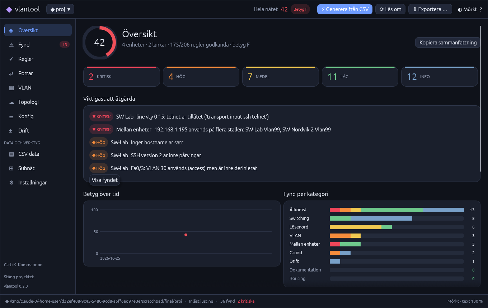
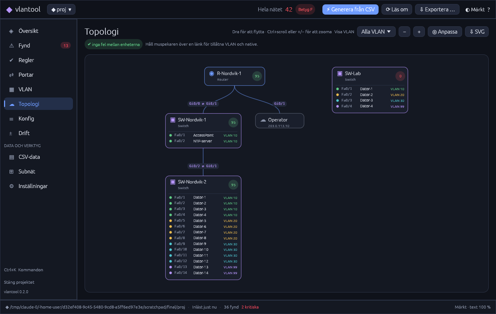
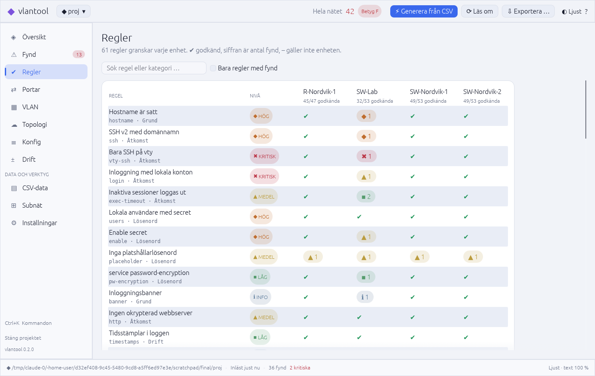

# vlantool – Nordvik-nätet i Rust

Rust-version av gruppens Python-verktyg [`felixarvid2/grupparbete-python-`](https://github.com/felixarvid2/grupparbete-python-) (`vlan-tool/`).
Det gör samma sak – bygger Cisco IOS-konfigar från CSV-filer och granskar dem – men med
många fler regler, granskning mellan enheterna, rättningsskript, rapporter i flera format, ett
skrivbordsprogram för Linux och ett terminalgränssnitt.



## Installera på Debian

```
sh packaging/build-deb.sh                      # bygger target/debian/vlantool_<version>_amd64.deb
sudo apt install ./target/debian/vlantool_*.deb
```

Sedan finns **vlantool** i programmenyn (eller kör `vlantool-gui` i en terminal). Paketet innehåller
också kommandoradsverktyget `vlantool`.

Paketet som byggs här kräver glibc 2.39, alltså **Debian 13 (trixie)** eller senare (Ubuntu 24.04
fungerar också). På Debian 12 bygger du från källkod i stället: installera Rust med
[rustup](https://rustup.rs) och kör `sh packaging/build-deb.sh` där, så följer paketet den glibc som finns.

Flaggan `--no-build` hoppar över `cargo build` och paketerar binärerna som redan finns i
`target/release/`. Bredvid paketet skrivs en `.sha256`-fil som kontrolleras med
`sha256sum -c vlantool_*.deb.sha256` i samma mapp. Paketet innehåller också man-sidor
(`man vlantool`, `man vlantool-gui`), AppStream-metadata och en ändringslogg; skalkomplettering för
bash, zsh och fish tas med när `vlantool completions` finns.

## Skrivbordsprogrammet

Första gången visas en välkomstsida som kan skapa ett exempelprojekt med gruppens CSV-filer
(`~/Dokument/vlantool-nordvik`). Ett projekt är en vanlig mapp med `samples/` (CSV),
`configs/` (konfigar), `reports/` (rapporter) och `nordvik.toml` (inställningar), så samma mapp
fungerar med kommandoradsverktyget.

| Flik | Innehåll |
|---|---|
| Översikt | Betyg för hela nätet, de fem viktigaste fynden, betygshistorik, fynd per kategori och kontroller mellan enheterna |
| Fynd | Fynd för en enhet eller hela nätet, sökning, nivåfilter, gruppering per regel, förklaring, rättning att kopiera, utdrag ur konfigen och "Ignorera regeln" |
| Regler | Alla 61 regler med status per enhet |
| Portar | Alla interface med läge, VLAN, beskrivning, status och portskydd; filter, sortering och kopiering som CSV |
| VLAN | Matris över var varje VLAN används; klicka ett VLAN för portar, nät och DHCP-pool |
| Topologi | Nätet som graf med zoom. Välj ett VLAN för att se vilka länkar som bär det, hovra över en länk för detaljer, exportera som SVG |
| Konfig | Konfigen med syntaxfärger, sökning, textstorlek och markeringar för fynd längs rullningslisten |
| Drift | Skillnaden mellan sparade konfigar och CSV-filerna, rad för rad eller sida vid sida, och "Skriv över bara denna" |
| CSV-data | Validering och redigering av ports.csv, dhcp.csv och devices.csv direkt i tabellen |
| Subnät | Subnätskalkylator med binär visning, uppdelning i lika delar och VLSM-plan som kan skrivas till dhcp.csv |
| Inställningar | Formulär för `nordvik.toml` med kontroll av IP-adresser direkt |

**Exportera** öppnar en dialog där du väljer rapportformat (HTML, Markdown, JSON, CSV, SARIF,
JUnit, text) och rättningsskript, som sparas i `reports/`. Programmet läser om projektet
automatiskt när filer ändras, sparar en säkerhetskopia av `configs/` innan generering skriver över,
och tar emot .cfg-filer som dras och släpps på fönstret.

Kortkommandon: `Ctrl+K` kommandopalett, `F1` hjälp, `Ctrl+G` generera, `F5` läs om, `Ctrl+O`
öppna mapp, `Ctrl+1…9` byt flik, `Ctrl+↑/↓` byt enhet, `Ctrl+F` sök, `Ctrl+=`/`Ctrl+−`/`Ctrl+0`
textstorlek, `Ctrl+T` byt tema (mörkt, ljust, högkontrast).

| Topologi | Regler (ljust tema) |
|---|---|
|  |  |

## Kommandoraden

```
vlantool                         # öppnar TUI:t (genererar konfigar från samples/ om inga finns)
vlantool run                     # allt i ett: validera CSV → generera → granska → HTML-rapport
```

### Kommandon

| Kommando | Vad det gör |
|---|---|
| `vlantool` / `vlantool tui` | Interaktiv översikt med flikar: översikt, fynd, portar, VLAN, topologi, konfig, drift, CSV och regler |
| `vlantool generate` | Bygger `configs/<enhet>.cfg` från CSV-filerna i `samples/` och visar +/− mot befintliga filer (`--dry-run`, `--only <enhet>`) |
| `vlantool validate` | Kontrollerar CSV-filerna: dubbla portar, överlappande nät, trunkar åt båda håll, IP-krockar … (`--format json`, `--fail-on`) |
| `vlantool audit [filer/mappar]` | Granskar konfigar (standard `configs/`). `--format terminal/text/markdown/json/csv/html/sarif/junit`, `-o rapport.html`, `--min medium`, `-r ssh`, `--summary`, `--fail-on high` för CI |
| `vlantool explain <regel>` | Förklarar en regel med ett riktigt exempel på fynd och rättning |
| `vlantool watch` | Granskar om varje gång en konfig eller CSV-fil ändras |
| `vlantool baseline save` / `compare` | Sparar fynden och visar sedan nya och åtgärdade fynd (`--fail-on` för CI) |
| `vlantool inventory` / `stats` | Tabeller över CSV-datan, portar per VLAN och beläggning i DHCP-poolerna |
| `vlantool fix` | Skriver rättningsskript per enhet till `reports/<enhet>_fix.txt`, färdiga att klistra in i CLI:t |
| `vlantool drift` | Jämför sparade konfigar med vad CSV-filerna säger att de borde vara |
| `vlantool diff a.cfg b.cfg` | Visar skillnaden mellan två konfigar (`--semantic` bryr sig inte om ordningen) |
| `vlantool topology` | Ritar nätet som ett träd utifrån portbeskrivningarna (`--format dot|mermaid` för Graphviz/Mermaid) |
| `vlantool rules` | Listar alla regler med förklaring (`--format markdown` gav [docs/regler.md](docs/regler.md)) |
| `vlantool subnet 192.168.1.0/24 --plan KONTOR:50,GAST:20` | Subnätskalkylator, `--split 26`, VLSM-planering och `--json` |
| `vlantool init` | Skapar `nordvik.toml` (`--example` skapar ett helt exempelprojekt) |
| `vlantool completions bash` | Skalkomplettering för bash, zsh, fish m.fl. (följer med i .deb-paketet) |

Globala flaggor: `--project <mapp>` (eller `VLANTOOL_PROJECT`), `--quiet`, `--no-color`.
Felkoder: 0 OK, 1 programfel eller skillnader (diff/drift), 2 fynd över gränsen.

En rad `! vlantool:ignore <regel> [text]` i en konfig hoppar över regeln för den enheten.

### TUI-tangenter

`1`–`9` / `←` `→` byter flik · `Tab` byter enhet · `↑` `↓` väljer fynd eller bläddrar ·
`/` söker (fynd och konfig, `n`/`N` nästa träff) · `f` nivåfilter · Enter hoppar till raden i
konfigen · `c` kopierar rättningen (OSC 52) · `t` ljust/mörkt · `g` genererar om · `r` läser om ·
`e` sparar HTML-rapport · `?` hjälp · `q` avslutar. Musen fungerar, och filer läses om automatiskt.

## Felsökning

**Fönstret öppnas inte, eller felet nämner OpenGL/EGL/GLX.** Programmet ritar med OpenGL. Saknas
grafikdrivrutin (virtuell maskin, fjärrskrivbord, container) kan mjukvarurendering användas:

```
LIBGL_ALWAYS_SOFTWARE=1 vlantool-gui
```

**Fel fönstersystem (Wayland eller X11).** Programmet använder Wayland om `WAYLAND_DISPLAY` är satt
och annars X11. Tvinga X11 genom att tömma Wayland-variabeln, eller välj backend med
`WINIT_UNIX_BACKEND`:

```
WAYLAND_DISPLAY= vlantool-gui          # X11 (via XWayland under Wayland)
WINIT_UNIX_BACKEND=x11 vlantool-gui
WINIT_UNIX_BACKEND=wayland vlantool-gui
```

**Programmet startar inte och nämner ett saknat bibliotek.** X11, Wayland och OpenGL laddas när
programmet startar. Paketet drar in dem, men har du kopierat binären för hand (eller installerat
med `dpkg -i` utan `apt`) kan något saknas:

```
sudo apt install libxkbcommon-x11-0 libxkbcommon0 libgl1 libegl1 libx11-6 \
                 libxcursor1 libxi6 libxrandr2 libwayland-client0 libwayland-cursor0 libwayland-egl1
```

Kör `ldd $(which vlantool-gui) | grep "not found"` för att se vad som saknas. Kommandoradsverktyget
`vlantool` behöver inga av dessa bibliotek.

**Texten ser fel ut eller emojin saknas.** Installera `fonts-dejavu-core` (rekommenderas av paketet).

## Jämfört med Python-versionen

| | Python | Rust |
|---|---|---|
| Regler | 4 | 61, med allvarlighetsgrad (kritisk → info), förklaring och rättning – se [docs/regler.md](docs/regler.md) |
| Granskning mellan enheter | – | native-VLAN och tillåtna VLAN på båda sidor av en trunk, router-subinterface mot switchens trunk, IP-krockar, gateway, VLAN-namn |
| Betyg | antal godkända regler | 0–100 och A–F per enhet och för hela nätet |
| CSV-kontroll | – | `validate` med ~20 kontroller innan något byggs |
| Rapporter | terminal + txt | terminal med färger, text, Markdown, JSON, CSV, SARIF, JUnit och fristående HTML med sökning, topologi och utskriftsläge |
| Genererade konfigar | grund | + `enable secret`, `service password-encryption`, banner, exec-timeout, SSH-skydd, `login block-for`, vty-ACL, rapid-PVST med root-prioritet, portfast/BPDU guard, `switchport nonegotiate`, port-security och röst-VLAN från CSV, NAT-ACL räknad från näten |
| Övrigt | – | skrivbordsprogram för Linux med .deb-paket, TUI, topologi, drift, diff, rättningsskript, subnät/VLSM, `nordvik.toml` |

Gruppens CSV-filer ligger i `samples/` och deras exempelkonfigar (`good.cfg`, `bad.cfg` …) i
`examples-cfg/`. Genererade konfigar får 100/100 när ett riktigt lösenord är satt i
`nordvik.toml` – med standardvärdet `CHANGE_ME` drar regeln `placeholder` av poäng med flit.

## Kända begränsningar

Samma som för Python-versionen: `crypto key generate rsa` hamnar inte i en konfigfil och måste
köras på varje enhet, och Packet Tracer visar inte `logging buffered`. Loggservern godkänns både
som `logging host <ip>` och Packet Tracers `logging <ip>`. Topologin och länkkontrollerna bygger
på portbeskrivningar som `Port mot SW-Nordvik-2`; utan dem hoppas de över.

## Utveckling

```
cargo test                                   # enhetstester, tests/ (CLI, nätmatte, robusthet) + hela kedjan CSV → konfig → granskning
cargo test snapshot -- --ignored --nocapture # skriver ut TUI:ts flikar som text
cargo clippy --all-targets -- -D warnings    # samma som i CI
cargo fmt --check                            # formatering (rustfmt.toml), också i CI
UPDATE_GOLDEN=1 cargo test --test golden     # skriv om facit när generatorn ändras med flit
cargo run --bin vlantool-gui -- <projektmapp>
cargo build --no-default-features            # bara kommandoraden, utan GUI-beroenden
```

GUI:t använder [egui/eframe](https://github.com/emilk/egui) och ritar allt själv med OpenGL, så
det behöver inga GTK- eller Qt-paket. `VLANTOOL_TAB=Topologi`, `VLANTOOL_DEVICE=1` och
`VLANTOOL_THEME=light` väljer startflik, enhet och tema (används till skärmbilderna).

Lägg till en regel: skriv en funktion `fn x(c: &Config) -> Vec<Finding>` i `src/rules.rs` och lägg
in den i `ALL_RULES`.

| Fil | Innehåll |
|---|---|
| `src/lib.rs` | Biblioteket som båda programmen använder |
| `src/inventory.rs` | Läser och validerar CSV-filerna |
| `src/generator.rs` | Bygger IOS-konfigar |
| `src/parser.rs` | Tolkar en sparad konfig till block och interface |
| `src/rules.rs` | Reglerna |
| `src/audit.rs` | Kör reglerna, betyg och kontroller mellan enheter |
| `src/report.rs` | Alla rapportformat |
| `src/project.rs` | Projektmappen och de inbyggda exempelfilerna |
| `src/tui.rs` | Terminalgränssnittet (ratatui) |
| `src/baseline.rs` | Spara fynd och jämför mot en tidigare körning |
| `src/topology.rs`, `src/diff.rs`, `src/net.rs` | Topologiträd/DOT/Mermaid, diff, IPv4-matte och VLSM |
| `src/gui/` | Skrivbordsprogrammet: `app.rs` (tillstånd och åtgärder), `views/` (en fil per flik), `palette.rs`, `history.rs`, `files.rs`, `theme.rs`, `folder.rs` |
| `tests/` | Integrationstester: `cli.rs` (kör binären), `golden.rs` (genererade konfigar mot facit), `net_math.rs`, `robust.rs` (slumpade konfigar) |
| `packaging/` | `build-deb.sh`, skrivbordsfil, AppStream, man-sidor, ikoner |
| `CHANGELOG.md` | Ändringslogg |
