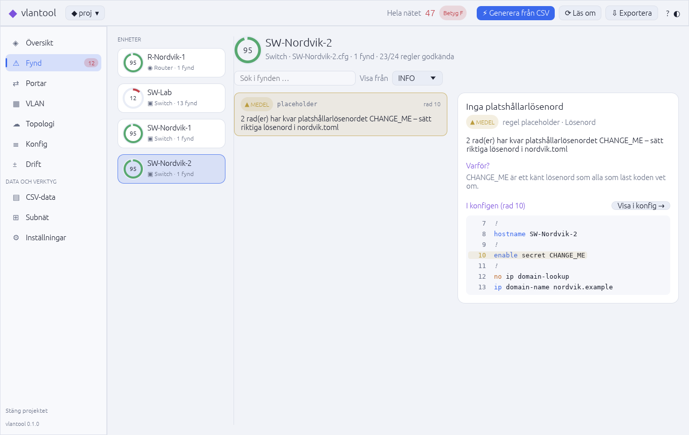

# vlantool – Nordvik-nätet i Rust

Rust-version av gruppens Python-verktyg [`felixarvid2/grupparbete-python-`](https://github.com/felixarvid2/grupparbete-python-) (`vlan-tool/`).
Det gör samma sak – bygger Cisco IOS-konfigar från CSV-filer och granskar dem – men med
många fler regler, granskning mellan enheterna, rättningsskript, rapporter i flera format, ett
skrivbordsprogram för Linux och ett terminalgränssnitt.


## Installera på Debian

```
sh packaging/build-deb.sh                      # bygger target/debian/vlantool_<version>_amd64.deb
sudo apt install ./target/debian/vlantool_*.deb
```

Sedan finns **vlantool** i programmenyn (eller kör `vlantool-gui` i en terminal). Paketet innehåller
också kommandoradsverktyget `vlantool`.

Paketet som byggs här kräver glibc 2.39, alltså **Debian 13 (trixie)** eller senare (Ubuntu 24.04
fungerar också). På Debian 12 bygger du från källkod i stället: installera Rust med
[rustup](https://rustup.rs) och kör `sh packaging/build-deb.sh` där, så följer paketet den glibc som finns.

## Skrivbordsprogrammet

Första gången visas en välkomstsida som kan skapa ett exempelprojekt med gruppens CSV-filer
(`~/Dokument/vlantool-nordvik`). Ett projekt är en vanlig mapp med `samples/` (CSV),
`configs/` (konfigar), `reports/` (rapporter) och `nordvik.toml` (inställningar), så samma mapp
fungerar med kommandoradsverktyget.

| Flik | Innehåll |
|---|---|
| Översikt | Betyg för hela nätet, antal fynd per nivå, kort per enhet och kontroller mellan enheterna |
| Fynd | Fynden för en enhet med sökning och filter, förklaring, rättning att kopiera och utdrag ur konfigen |
| Portar | Alla interface med läge, VLAN, beskrivning, status och portskydd |
| VLAN | Matris över var varje VLAN används: accessportar, trunkar, gateway och native |
| Topologi | Nätet ritat som en graf, med zoom och panorering. Dubbelklicka en enhet för att se dess fynd |
| Konfig | Konfigen med syntaxfärger och markeringar på raderna som har fynd |
| Drift | Skillnaden mellan sparade konfigar och vad CSV-filerna säger |
| CSV-data | Validering av CSV-filerna och tabeller över portar, DHCP och hanterings-IP |
| Subnät | Subnätskalkylator, uppdelning i lika delar och VLSM-plan med stapel |
| Inställningar | Formulär för `nordvik.toml` (domän, servrar, lösenord, VLAN, WAN …) |

**Exportera** sparar HTML-, Markdown-, JSON-, CSV- eller textrapport och rättningsskript i
`reports/`. Ljust och mörkt tema byts med ☀/◐ uppe till höger.

Kortkommandon: `Ctrl+G` generera, `F5` läs om, `Ctrl+O` öppna mapp, `Ctrl+1…9` byt flik,
`Ctrl+↑/↓` byt enhet, `Ctrl+T` byt tema.

| Topologi | Fynd (ljust tema) |
|---|---|
|  |  |

## Kommandoraden

```
vlantool                         # öppnar TUI:t (genererar konfigar från samples/ om inga finns)
vlantool run                     # allt i ett: validera CSV → generera → granska → HTML-rapport
```

### Kommandon

| Kommando | Vad det gör |
|---|---|
| `vlantool` / `vlantool tui` | Interaktiv översikt med flikar: översikt, fynd, portar, VLAN-matris, topologi och konfig med syntaxfärger |
| `vlantool generate` | Bygger `configs/<enhet>.cfg` från CSV-filerna i `samples/` (`--dry-run` skriver bara ut) |
| `vlantool validate` | Kontrollerar CSV-filerna: dubbla portar, överlappande nät, gateway utanför nätet, IP-krockar, hanterings-IP i DHCP-poolen … |
| `vlantool audit [filer/mappar]` | Granskar konfigar (standard `configs/`). `--format terminal/text/markdown/json/csv/html`, `-o rapport.html`, `--min medium`, `-r ssh -r trunk`, `--fail-on high` för CI |
| `vlantool fix` | Skriver rättningsskript per enhet till `reports/<enhet>_fix.txt`, färdiga att klistra in i CLI:t |
| `vlantool drift` | Jämför sparade konfigar med vad CSV-filerna säger att de borde vara |
| `vlantool diff a.cfg b.cfg` | Visar skillnaden mellan två konfigar (kommentarer räknas inte) |
| `vlantool topology` | Ritar nätet som ett träd utifrån portbeskrivningarna (`Port mot X`) |
| `vlantool rules` | Listar alla regler med förklaring |
| `vlantool subnet 192.168.1.0/24 --plan KONTOR:50,GAST:20` | Subnätskalkylator, `--split 26` och VLSM-planering |
| `vlantool init` | Skapar `nordvik.toml` så att domän, servrar, lösenord, VLAN m.m. kan ändras utan att röra koden |

### TUI-tangenter

`1`–`6` / `←` `→` byter flik · `Tab` byter enhet · `↑` `↓` väljer fynd eller bläddrar ·
`g` genererar om från CSV · `r` läser om · `e` sparar HTML-rapport · `?` hjälp · `q` avslutar.

## Jämfört med Python-versionen

| | Python | Rust |
|---|---|---|
| Regler | 4 | 28, med allvarlighetsgrad (kritisk → info), förklaring och rättning |
| Granskning mellan enheter | – | native-VLAN och tillåtna VLAN på båda sidor av en trunk, router-subinterface mot switchens trunk, IP-krockar, gateway, VLAN-namn |
| Betyg | antal godkända regler | 0–100 och A–F per enhet och för hela nätet |
| CSV-kontroll | – | `validate` med ~20 kontroller innan något byggs |
| Rapporter | terminal + txt | terminal med färger, text, Markdown, JSON, CSV och fristående HTML (ljust/mörkt tema) |
| Genererade konfigar | grund | + `enable secret`, `service password-encryption`, banner, exec-timeout, rapid-PVST, portfast/BPDU guard, `switchport nonegotiate`, NAT-ACL räknad från näten |
| Övrigt | – | skrivbordsprogram för Linux med .deb-paket, TUI, topologi, drift, diff, rättningsskript, subnät/VLSM, `nordvik.toml` |

Gruppens CSV-filer ligger i `samples/` och deras exempelkonfigar (`good.cfg`, `bad.cfg` …) i
`examples-cfg/`. Genererade konfigar får 100/100 när ett riktigt lösenord är satt i
`nordvik.toml` – med standardvärdet `CHANGE_ME` drar regeln `placeholder` av poäng med flit.

## Kända begränsningar

Samma som för Python-versionen: `crypto key generate rsa` hamnar inte i en konfigfil och måste
köras på varje enhet, och Packet Tracer visar inte `logging buffered`. Loggservern godkänns både
som `logging host <ip>` och Packet Tracers `logging <ip>`. Topologin och länkkontrollerna bygger
på portbeskrivningar som `Port mot SW-Nordvik-2`; utan dem hoppas de över.

## Utveckling

```
cargo test                                   # enhetstester + hela kedjan CSV → konfig → granskning
cargo test snapshot -- --ignored --nocapture # skriver ut TUI:ts flikar som text
cargo clippy --all-targets
cargo run --bin vlantool-gui -- <projektmapp>
cargo build --no-default-features            # bara kommandoraden, utan GUI-beroenden
```

GUI:t använder [egui/eframe](https://github.com/emilk/egui) och ritar allt själv med OpenGL, så
det behöver inga GTK- eller Qt-paket. `VLANTOOL_TAB=Topologi`, `VLANTOOL_DEVICE=1` och
`VLANTOOL_THEME=light` väljer startflik, enhet och tema (används till skärmbilderna).

Lägg till en regel: skriv en funktion `fn x(c: &Config) -> Vec<Finding>` i `src/rules.rs` och lägg
in den i `ALL_RULES`.

| Fil | Innehåll |
|---|---|
| `src/lib.rs` | Biblioteket som båda programmen använder |
| `src/inventory.rs` | Läser och validerar CSV-filerna |
| `src/generator.rs` | Bygger IOS-konfigar |
| `src/parser.rs` | Tolkar en sparad konfig till block och interface |
| `src/rules.rs` | Reglerna |
| `src/audit.rs` | Kör reglerna, betyg och kontroller mellan enheter |
| `src/report.rs` | Alla rapportformat |
| `src/project.rs` | Projektmappen och de inbyggda exempelfilerna |
| `src/tui.rs` | Terminalgränssnittet (ratatui) |
| `src/topology.rs`, `src/diff.rs`, `src/net.rs` | Topologiträd, diff, IPv4-matte och VLSM |
| `src/gui/` | Skrivbordsprogrammet: `app.rs` (tillstånd och åtgärder), `views.rs` (flikarna), `theme.rs`, `folder.rs` |
| `packaging/` | `build-deb.sh`, skrivbordsfil, ikoner |
